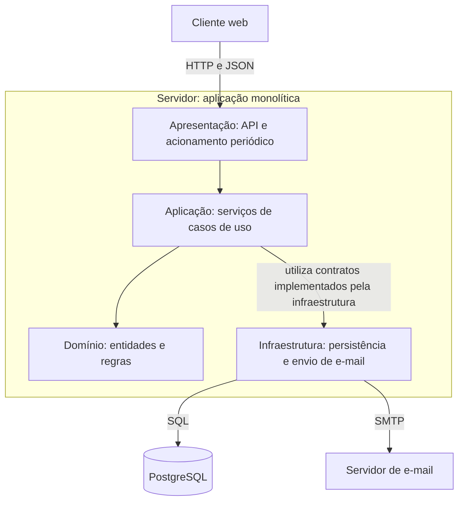
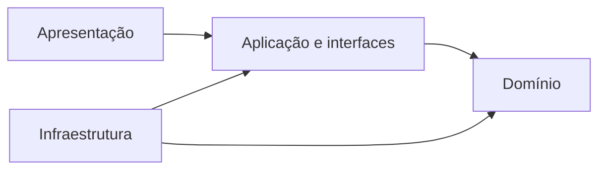

# Arquitetura do sistema

## 1. Visão geral

O Sistema de Manutenção de Equipamentos de Laboratório organiza o atendimento de solicitações da universidade, desde a abertura do chamado até a conclusão da manutenção. Permite consultar chamados, definir prioridades, atribuir técnicos, registrar intervenções, encaminhar atendimentos entre departamentos e preservar o histórico dos equipamentos.

A arquitetura escolhida combina **monólito, cliente-servidor e organização em quatro camadas: apresentação, aplicação, domínio e infraestrutura**.

O backend é uma única aplicação. Seus componentes colaboram por chamadas internas, enquanto os clientes acessam as funcionalidades por uma API HTTP com dados em JSON. As camadas separam a comunicação com o usuário, a coordenação dos casos de uso, as regras de negócio e os mecanismos de persistência e envio de e-mails.

As decisões arquiteturais são orientadas por três requisitos arquiteturalmente significativos: rastreabilidade do histórico de manutenção, controle de acesso por papel e departamento e confiabilidade das notificações. Os requisitos estão descritos em [requisitos.md](requisitos.md).

## 2. Arquitetura escolhida e justificativas

### 2.1. Monólito

As funcionalidades do servidor pertencem a uma única aplicação, desenvolvida e implantada como uma unidade. A abertura, consulta, atribuição, conclusão e demais operações compartilham o mesmo ambiente de execução e o mesmo banco de dados.

Essa escolha reduz o esforço de configuração, implantação e acompanhamento da aplicação. Também permite realizar transações locais para confirmar conjuntamente uma alteração no chamado, seu registro de auditoria e a notificação correspondente.

A consistência transacional é relevante porque uma conclusão não deve ser salva sem o histórico da operação ou sem a comunicação pendente ao solicitante. Se a gravação falhar, a operação deve ser revertida integralmente.

A aplicação acessa PostgreSQL e um servidor de e-mail como dependências externas. A execução desses serviços em processos ou contêineres separados não altera a natureza monolítica do backend.

A principal consequência dessa escolha é que as funcionalidades são implantadas e escaladas conjuntamente. Para o escopo do sistema, a simplicidade operacional e a facilidade de manter consistência justificam essa limitação.

### 2.2. Cliente-servidor

Os usuários acessam o sistema por um cliente web. O cliente apresenta informações, coleta dados e envia solicitações ao servidor. O servidor verifica permissões, executa as regras do atendimento e acessa os dados persistidos.

Essa organização centraliza as informações dos laboratórios, permitindo que solicitantes, técnicos e coordenadores consultem o andamento dos chamados de diferentes computadores.

A autorização ocorre no servidor, inclusive quando a solicitação é enviada diretamente pela API. Ocultar uma ação na interface melhora a experiência do usuário, mas não substitui a verificação de permissão.

A separação entre cliente e servidor também permite acrescentar outros clientes, como um aplicativo mobile, sem reproduzir as regras de negócio em cada interface.

### 2.3. Organização em camadas

O código é organizado conforme quatro tipos de responsabilidade:

1. **Apresentação:** comunicação com os clientes e acionamento dos casos de uso.
2. **Aplicação:** coordenação das operações e verificação das permissões.
3. **Domínio:** conceitos, regras e invariantes do atendimento.
4. **Infraestrutura:** acesso ao banco de dados e comunicação com serviços externos.

Essa separação facilita compreender onde cada decisão deve ser implementada. Uma alteração no formato da requisição pertence à apresentação; uma regra de conclusão pertence ao domínio; uma mudança no acesso ao banco pertence à infraestrutura.

As camadas são divisões lógicas da mesma aplicação. Elas não precisam executar em servidores diferentes nem se comunicar por HTTP entre si.

## 3. Visão dos componentes



O diagrama representa a colaboração em execução. A aplicação utiliza a infraestrutura por contratos; a direção das dependências de código é detalhada na seção 5.

| Componente | Responsabilidade |
|---|---|
| Cliente web | Exibir dados, coletar informações e enviar solicitações |
| Controllers e esquemas | Receber requisições, validar sua estrutura e produzir respostas |
| Serviços de aplicação | Coordenar operações, verificar autorização e solicitar persistência |
| Entidades de domínio | Representar o atendimento e validar suas regras |
| Repositórios | Recuperar e persistir os dados necessários aos casos de uso |
| Notificador | Executar a comunicação com o serviço de e-mail |
| Agendador | Acionar periodicamente o processamento de notificações pendentes |
| Configuração inicial | Criar e conectar os componentes concretos |

## 4. Responsabilidades das camadas

### 4.1. Apresentação

A apresentação recebe requisições HTTP, interpreta parâmetros e corpos JSON e encaminha as operações aos serviços de aplicação. Também converte resultados e erros em respostas adequadas ao cliente.

A validação estrutural verifica campos obrigatórios e formatos. Regras como a permissão para concluir um chamado ou a validade de uma transição não ficam restritas ao controller.

O acionamento periódico das notificações também inicia um caso de uso. O agendador determina quando executar o processamento, enquanto o serviço de aplicação coordena suas etapas.

### 4.2. Aplicação

A aplicação organiza os passos necessários para realizar cada caso de uso. Suas responsabilidades incluem:

- verificar a autorização do usuário;
- recuperar equipamentos, chamados e vínculos necessários;
- solicitar às entidades a execução das regras de negócio;
- preparar os registros de auditoria e as notificações;
- coordenar a confirmação transacional das alterações;
- devolver os resultados à apresentação.

Os serviços podem ser separados por conjuntos coesos de casos de uso, como atendimento e processamento de notificações. Essa distribuição evita concentrar todas as operações em uma única classe, mantendo a organização pelas quatro camadas.

A aplicação utiliza interfaces de persistência e notificação. Ela não incorpora comandos SQL nem operações de protocolo SMTP.

### 4.3. Domínio

O domínio representa os conceitos do problema e mantém as regras que devem ser respeitadas independentemente da interface ou da tecnologia de persistência.

| Entidade | Responsabilidade |
|---|---|
| `Chamado` | Representar a solicitação e controlar prioridade, estado e departamento responsável |
| `Equipamento` | Identificar o equipamento, sua descrição, localização e departamento |
| `Usuario` | Representar solicitantes, técnicos e coordenadores |
| `Departamento` | Identificar as unidades responsáveis pelos atendimentos |
| `VinculoDepartamento` | Relacionar usuários a departamentos, funções e autorizações |
| `AtribuicaoTecnico` | Registrar o técnico responsável e o período de sua participação |
| `Intervencao` | Registrar diagnóstico, atividade executada, resultado, técnico e data |
| `RegistroAuditoria` | Preservar autor, instante e informações de uma alteração |
| `Notificacao` | Manter conteúdo, destinatário, situação da entrega e tentativas |

Um equipamento pode possuir vários chamados. Cada chamado pode reunir diferentes atribuições e intervenções, preservando a participação de vários técnicos ao longo do atendimento.

O fluxo principal de estados é:

```text
Aberto → Atribuído → Em atendimento → Concluído
```

O domínio deve impedir transições inválidas e exigir diagnóstico e intervenção para concluir o atendimento. Também deve preservar as atribuições e atividades anteriores quando ocorrer um encaminhamento.

As entidades não acessam diretamente HTTP, PostgreSQL ou SMTP. Essa independência permite verificar suas regras sem iniciar serviços externos.

### 4.4. Infraestrutura

A infraestrutura implementa o acesso às tecnologias escolhidas. Os repositórios executam consultas e gravações no PostgreSQL e convertem dados persistidos em objetos do domínio. O notificador realiza o envio por SMTP.

As transações são executadas pelos mecanismos de persistência, respeitando a unidade de trabalho definida pelo caso de uso. O envio de e-mail ocorre fora da transação de alteração do chamado.

Implementações em memória e notificadores simulados permitem testar a aplicação sem depender de banco ou serviço de e-mail em execução.

## 5. Dependências e interfaces

A organização em camadas utiliza inversão de dependências para preservar a independência das regras de negócio em relação às tecnologias externas.



As setas representam dependências de código:

- a apresentação depende dos serviços de aplicação;
- a aplicação depende do domínio e de contratos definidos para suas necessidades;
- a infraestrutura implementa esses contratos e conhece as entidades que persiste;
- o domínio não depende das outras camadas.

A aplicação pode chamar um repositório PostgreSQL durante a execução sem importar sua classe concreta: recebe um objeto que atende à interface esperada. A escolha e a conexão das implementações são feitas na inicialização do sistema, por injeção de dependências.

| Interface ou contrato | Finalidade |
|---|---|
| Persistência | Buscar e salvar os dados necessários aos casos de uso |
| Notificação | Enviar uma comunicação e informar sucesso ou falha |
| Coordenação transacional | Confirmar ou reverter conjuntamente os registros da operação |

Os contratos devem definir retornos, erros e garantias comportamentais. Sua divisão deve acompanhar as necessidades dos consumidores, evitando interfaces excessivamente abrangentes.

## 6. Comunicação e API

A comunicação entre cliente e servidor utiliza HTTP e JSON, com operações orientadas aos recursos do sistema. A API deve oferecer abertura e consulta de chamados, filtros, alteração de prioridade, atribuição, início, conclusão, encaminhamento e consulta do histórico.

A documentação OpenAPI descreve parâmetros, esquemas, resultados e erros. A API deve distinguir dados inválidos, ausência de autenticação, falta de permissão, recurso inexistente e conflito com o estado do atendimento.

As chamadas entre componentes do backend são internas e síncronas. O processamento de notificações ocorre posteriormente à operação que o originou, pois sua execução depende da disponibilidade de um serviço externo.

A identidade usada para autorizar operações deve ser estabelecida por um mecanismo confiável de autenticação. Um identificador informado pelo cliente, isoladamente, não comprova a identidade do usuário. As políticas de autorização permanecem na aplicação, independentemente do mecanismo escolhido para autenticar.

## 7. Fluxos principais

### 7.1. Abertura de chamado

1. O cliente informa equipamento, descrição, data da ocorrência e informações adicionais.
2. A apresentação valida a estrutura e aciona a aplicação.
3. A aplicação verifica o usuário e a existência do equipamento.
4. O domínio cria o chamado aberto, associado ao solicitante e ao departamento responsável.
5. A aplicação prepara auditoria e notificação de confirmação.
6. O mecanismo de persistência salva os registros na mesma transação.
7. O cliente recebe a confirmação; o e-mail é enviado posteriormente.

Equipamento inexistente ou dados inválidos impedem a abertura. Uma falha de persistência não deve deixar apenas parte dos registros salva.

### 7.2. Conclusão de chamado

1. A aplicação recupera o chamado e verifica se o usuário é um técnico autorizado e atribuído ao atendimento.
2. O domínio valida o estado e a presença do diagnóstico e da intervenção.
3. São registrados a atividade realizada, a conclusão, seu autor e a data e hora.
4. A aplicação prepara auditoria e notificação ao solicitante.
5. A persistência confirma todas as alterações na mesma transação.
6. A API devolve o resultado; o envio da comunicação ocorre separadamente.

Uma falha de autorização ou validação impede a alteração. Uma falha do serviço de e-mail não desfaz uma conclusão já confirmada.

### 7.3. Consulta e histórico

A aplicação combina os filtros de equipamento, prioridade, técnico, estado, período, solicitante e departamento com as restrições de visibilidade do usuário.

Solicitantes consultam seus próprios chamados. Técnicos e coordenadores consultam chamados do departamento autorizado. Após um encaminhamento, o acesso acompanha o departamento responsável, preservando o acesso do solicitante e o histórico da transferência.

O histórico do equipamento reúne chamados anteriores, intervenções, técnicos e datas relevantes, permitindo compreender os problemas e as soluções adotadas.

## 8. Persistência e implantação

O sistema utiliza **PostgreSQL**, adequado às relações entre equipamentos, chamados, usuários, atribuições e intervenções. As transações garantem a confirmação conjunta dos dados de atendimento, auditoria e notificações.

O acesso é realizado com SQL e `psycopg`, concentrados na infraestrutura. Essa escolha mantém explícitas as consultas e transações e evita acrescentar uma ferramenta de mapeamento sem necessidade do escopo. A [ADR-001](adr/ADR-001.md) detalha a decisão de persistência e ambiente.

Chaves estrangeiras e restrições de integridade complementam as validações de negócio. Entretanto, limitar os valores permitidos para um estado não substitui a validação da sequência de transições pelo domínio.

O ambiente utiliza Docker Compose para iniciar a aplicação Python/FastAPI, PostgreSQL e Mailpit, que recebe os e-mails de demonstração. O banco utiliza volume persistente. As configurações de conexão são fornecidas externamente à lógica de negócio.

O backend é implantado como uma unidade. As quatro camadas fazem parte dessa aplicação e compartilham seu ciclo de execução.

## 9. Atendimento aos ASRs

### 9.1. ASR01 — Rastreabilidade do histórico de manutenção

Cada alteração relevante deve produzir um registro que identifique chamado, autor, instante, informação modificada e, quando aplicável, valores anteriores e posteriores. Isso inclui mudanças de prioridade, estado, atribuições, departamento e registros de intervenções.

A alteração e sua auditoria são persistidas na mesma transação. Os registros de auditoria não devem ser sobrescritos por operações comuns; a persistência deve protegê-los contra alterações e exclusões indevidas.

Atribuições e intervenções são registradas individualmente para preservar a participação dos técnicos e as atividades executadas.

**Justificativa:** o estado atual de um chamado não explica toda sua evolução. A auditoria e os registros históricos permitem reconstruir o atendimento e evitam que atualizações apaguem informações anteriores.

**Verificação:** executar uma sequência de operações e consultar quem realizou cada mudança, quando ocorreu e quais dados foram alterados.

### 9.2. ASR02 — Controle de acesso por papel e departamento

A aplicação verifica a autorização antes de cada operação, considerando identidade, papel, vínculo departamental e relação com o chamado. Essa verificação também se aplica às consultas e ao acesso direto pela API.

A recusa de uma operação não deve modificar o chamado. As regras não dependem de controles visuais presentes no cliente.

**Justificativa:** os usuários possuem responsabilidades diferentes e pertencem a departamentos distintos. A verificação centralizada no servidor mantém uma política consistente para todas as formas de acesso.

**Verificação:** tentar consultar e modificar chamados fora do escopo permitido, confirmando a recusa e a preservação dos dados.

### 9.3. ASR03 — Confiabilidade das notificações

A notificação pendente é salva na mesma transação da abertura ou conclusão que a originou. Um processador periódico recupera as pendências, tenta enviá-las e registra o resultado.

O processamento utiliza registros persistidos no banco, permitindo a recuperação após reinícios. A tentativa de envio ocorre sem manter aberta a transação de alteração do chamado.

Falhas de comunicação devem preservar a mensagem para recuperação. As novas tentativas precisam ter intervalos controlados. Se houver limite automático, as mensagens que o atingirem devem permanecer consultáveis e possuir um fluxo de reprocessamento explícito.

O processamento concorrente deve coordenar a seleção das pendências. Mesmo com essa coordenação, uma falha após o serviço externo aceitar a mensagem e antes de salvar o sucesso pode causar repetição. A solução deve considerar identificação de mensagens e deduplicação quando houver suporte do serviço externo, sem pressupor entrega exatamente uma vez.

**Justificativa:** a disponibilidade do serviço de e-mail não deve determinar o sucesso do atendimento. A gravação da pendência permite separar a confirmação da operação da entrega da comunicação.

**Verificação:** interromper o serviço de e-mail, abrir ou concluir um chamado, confirmar a persistência da operação e da mensagem e verificar a retomada após o restabelecimento do serviço.

## 10. Princípios de design

### 10.1. GRASP

| Princípio | Aplicação |
|---|---|
| **Information Expert** | Chamado valida seu ciclo de vida; intervenção mantém os dados da atividade; notificação controla sua situação de entrega |
| **Controller** | Controllers recebem solicitações e serviços de aplicação coordenam os casos de uso |
| **Low Coupling** | Interfaces reduzem a dependência das regras em relação ao banco e ao serviço de e-mail |
| **High Cohesion** | Classes e camadas agrupam responsabilidades relacionadas, distinguindo negócio, coordenação e tecnologia |
| **Polymorphism** | Implementações diferentes atendem aos mesmos contratos de persistência e notificação |
| **Indirection e Protected Variations** | Contratos limitam o impacto das mudanças tecnológicas sobre seus consumidores |

### 10.2. SOLID

| Princípio | Aplicação |
|---|---|
| **SRP — Responsabilidade única** | Separar regras de atendimento, coordenação, persistência, composição de mensagens e envio |
| **OCP — Aberto/fechado** | Permitir novas implementações de integrações preservando consumidores de contratos compatíveis |
| **LSP — Substituição de Liskov** | Exigir que implementações alternativas mantenham as garantias de retorno, erro e persistência |
| **ISP — Segregação de interfaces** | Definir interfaces conforme as necessidades dos consumidores |
| **DIP — Inversão de dependências** | Fazer a aplicação depender de abstrações, com implementações concretas fornecidas na inicialização |

Esses princípios orientam a distribuição de responsabilidades. A criação de interfaces deve responder a necessidades concretas de substituição, teste ou separação de responsabilidades.

## 11. Evolução da solução

| Mudança | Partes afetadas | Partes preservadas e condições |
|---|---|---|
| **Substituir PostgreSQL** | Repositórios concretos, esquema, configuração e implantação | Domínio e casos de uso podem permanecer se os contratos e as garantias transacionais forem mantidos |
| **Trocar provedor de e-mail** | Configuração e eventualmente implementação do notificador | Regras do atendimento e processamento de pendências permanecem compatíveis com o contrato |
| **Adicionar outro canal de comunicação** | Envio, destinatário, composição do conteúdo e possivelmente o contrato de notificação | Separação entre atendimento e entrega continua aplicável |
| **Adicionar aplicativo mobile** | Novo cliente e eventual ampliação da API | Serviços de aplicação, domínio e políticas de autorização são reutilizados |
| **Aumentar a carga** | Consultas, índices, recursos de execução e coordenação do processamento concorrente | Organização em camadas pode permanecer; transações e concorrência precisam ser verificadas |

As mudanças são avaliadas conforme as responsabilidades afetadas. A separação entre apresentação, aplicação, domínio e infraestrutura permite substituir mecanismos técnicos preservando, sempre que os contratos forem mantidos, as regras do atendimento e as garantias dos ASRs.
