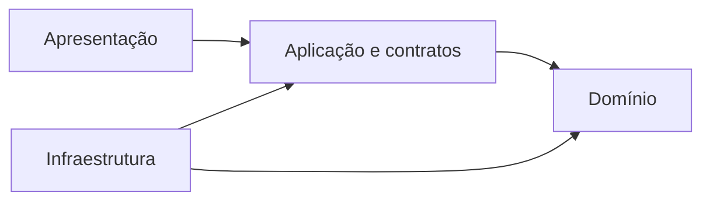

# Arquitetura do sistema

## 1. Visão geral

O Sistema de Manutenção de Equipamentos de Laboratório organiza o atendimento de solicitações da universidade, desde a abertura do chamado até a conclusão da manutenção. A solução permite consultar chamados, definir prioridades, atribuir técnicos, registrar intervenções, encaminhar atendimentos entre departamentos e preservar o histórico dos equipamentos.

A arquitetura escolhida combina **cliente-servidor, monólito modular, organização em camadas e API REST**. As integrações com persistência e envio de notificações utilizam interfaces, seguindo o princípio da inversão de dependências e características de portas e adaptadores.

A escolha atende a três preocupações centrais:

- **Rastreabilidade:** preservar quem realizou cada alteração, quando ela ocorreu e quais informações foram modificadas.
- **Controle de acesso:** autorizar operações conforme o papel do usuário, seu vínculo departamental e sua relação com o chamado.
- **Confiabilidade das notificações:** manter o atendimento registrado mesmo quando o serviço de comunicação estiver indisponível.

A solução privilegia uma implantação simples, transações locais e separação de responsabilidades. As decisões são orientadas pelos [requisitos e ASRs](requisitos.md).

## 2. Estilos arquiteturais e justificativas

### 2.1. Cliente-servidor

Os usuários acessam a aplicação por um cliente web, que envia requisições HTTP e recebe respostas JSON. O servidor executa os casos de uso, aplica as regras de autorização e acessa a persistência. O cliente não acessa diretamente o banco de dados.

Essa organização centraliza as informações dos laboratórios e permite que solicitantes, técnicos e coordenadores compartilhem uma visão consistente dos atendimentos. Também concentra a aplicação das permissões no servidor: uma operação deve ser validada mesmo quando solicitada diretamente pela API.

A API permite acrescentar outros clientes, como um aplicativo mobile, reutilizando os mesmos casos de uso e regras de negócio.

### 2.2. Monólito modular

O backend é uma única aplicação, com implantação conjunta e módulos organizados por capacidades de negócio. Cada módulo possui responsabilidades definidas e expõe operações para colaboração com os demais. Os detalhes internos de um módulo não devem ser acessados diretamente por outro.

A implantação única reduz a complexidade operacional e permite utilizar transações locais para salvar alterações de chamados, auditoria e notificações. Essa característica é especialmente relevante para a rastreabilidade e a consistência do atendimento.

A modularização limita a propagação de mudanças. Uma alteração no processamento de notificações, por exemplo, deve permanecer concentrada nos componentes responsáveis por essa capacidade, preservando as regras do ciclo de vida dos chamados.

O banco de dados compartilhado é uma escolha de persistência e não elimina os limites lógicos entre módulos. O acesso aos dados deve respeitar os contratos e as responsabilidades definidos, evitando que um módulo altere diretamente tabelas pertencentes a outro.

### 2.3. Organização em camadas

As responsabilidades são distribuídas em quatro camadas: apresentação, aplicação, domínio e infraestrutura. Essa organização é aplicada aos módulos conforme a necessidade de cada um.

A separação distingue a forma de receber uma solicitação, a coordenação do caso de uso, as regras de negócio e os mecanismos técnicos. Dessa maneira, alterações em HTTP, SQL ou SMTP não precisam modificar as regras de manutenção.

### 2.4. Portas e adaptadores

Os casos de uso acessam persistência e comunicação externa por interfaces. As implementações concretas ficam na infraestrutura.

As interfaces funcionam como portas, enquanto os componentes de PostgreSQL e SMTP funcionam como adaptadores. A API e o agendador são adaptadores de entrada: ambos acionam casos de uso, por requisição de usuário ou pelo relógio.

Essa decisão permite substituir integrações e utilizar implementações simuladas nos testes, sem incorporar detalhes técnicos ao domínio.

## 3. Módulos e responsabilidades

| Módulo | Responsabilidades | Contratos de colaboração |
|---|---|---|
| **Chamados e manutenção** | Abertura, prioridade, atribuição de técnicos, início, intervenções, encaminhamento, conclusão e histórico do atendimento | Recebe operações de atendimento; consulta equipamentos e vínculos; solicita registro de auditoria e notificações |
| **Equipamentos** | Identificação patrimonial, descrição, localização e departamento dos equipamentos | Disponibiliza consulta de equipamentos existentes e seus dados |
| **Usuários e departamentos** | Usuários, departamentos, funções e vínculos que fundamentam a autorização | Disponibiliza informações de identidade de negócio e vínculos departamentais |
| **Notificações** | Comunicações pendentes, conteúdo, destinatários, tentativas e resultado da entrega | Recebe solicitações de comunicação e disponibiliza processamento de pendências |

A auditoria é uma responsabilidade transversal associada às operações que modificam o atendimento. Seu registro participa da mesma transação da alteração relevante, evitando que uma mudança seja confirmada sem o histórico correspondente.

A colaboração entre módulos ocorre por chamadas internas a contratos de aplicação. Não são necessárias chamadas HTTP entre módulos do mesmo backend. O módulo de chamados coordena o atendimento; notificações não alteram o estado dos chamados, e equipamentos não dependem do processamento de mensagens.

## 4. Camadas e direção das dependências

| Camada | Responsabilidade | Exemplos |
|---|---|---|
| **Apresentação** | Receber solicitações, validar sua estrutura, converter respostas e erros e acionar casos de uso | Controllers HTTP, esquemas de entrada e saída e agendador |
| **Aplicação** | Coordenar casos de uso, verificar autorização, recuperar entidades e definir a unidade transacional | Serviços de abertura, consulta, atribuição e conclusão; interfaces de persistência e notificação |
| **Domínio** | Representar conceitos e proteger regras e invariantes do atendimento | Chamado, intervenção, atribuição de técnico, vínculos e regras de transição |
| **Infraestrutura** | Implementar persistência e comunicação com tecnologias externas | Repositórios PostgreSQL, adaptador SMTP e implementações simuladas |

O domínio não depende de HTTP, banco de dados ou serviço de e-mail. A aplicação depende do domínio e de abstrações. A infraestrutura implementa essas abstrações. A apresentação chama a aplicação e não executa SQL nem decide regras do ciclo de vida.



As setas representam dependências de código. Em tempo de execução, a aplicação utiliza um objeto de infraestrutura por meio de sua interface, sem depender da classe concreta.

Um ponto de composição conecta serviços, repositórios, notificadores e adaptadores de entrada. A escolha das implementações é feita na inicialização, por configuração, e as dependências são fornecidas aos componentes por seus construtores.

## 5. Modelo de domínio e distribuição de responsabilidades

O modelo de domínio é orientado a objetos e reúne dados e comportamentos relacionados ao atendimento. As regras devem permanecer próximas dos conceitos que possuem as informações necessárias para aplicá-las.

| Entidade | Responsabilidade |
|---|---|
| **Chamado** | Representar a solicitação, controlar seu ciclo de vida, definir prioridade e departamento responsável e validar operações de atendimento |
| **Equipamento** | Identificar o equipamento, sua descrição, localização e vínculo departamental |
| **Usuario** | Representar as pessoas que solicitam, executam ou coordenam atendimentos |
| **Departamento** | Representar a unidade responsável pelo atendimento |
| **VinculoDepartamento** | Associar usuário e departamento, incluindo função e autorização |
| **AtribuicaoTecnico** | Registrar a participação de um técnico e seu período de responsabilidade, preservando atribuições anteriores |
| **Intervencao** | Registrar diagnóstico, serviço executado, resultado, técnico e data da atividade |
| **RegistroAuditoria** | Preservar autor, instante e informações anteriores e posteriores de uma alteração |
| **Notificacao** | Representar conteúdo, destinatário, situação da entrega e tentativas de comunicação |

Um equipamento pode possuir vários chamados. Um chamado pode reunir diversas atribuições e intervenções, permitindo registrar a participação de profissionais diferentes ao longo do atendimento.

O fluxo principal de estados é:

```text
Aberto → Atribuído → Em atendimento → Concluído
```

O chamado deve impedir transições inválidas, como a conclusão diretamente a partir do estado aberto. A conclusão exige diagnóstico e intervenção registrados, além da identificação do técnico e do instante da operação.

As políticas de autorização consideram papel, vínculo departamental e relação com o chamado. A aplicação verifica essas condições antes de executar a operação, e o domínio preserva as invariantes do atendimento. Encaminhamentos devem conservar intervenções e atribuições anteriores, registrar a justificativa e atualizar a responsabilidade departamental.

## 6. Interfaces e integração entre componentes

As interfaces são definidas de acordo com as necessidades dos casos de uso. Seus contratos devem especificar entradas, retornos, erros e garantias de persistência.

| Contrato | Finalidade |
|---|---|
| **Persistência de chamados** | Recuperar e salvar chamados e seus registros relacionados, incluindo consultas com filtros |
| **Consulta de equipamentos** | Verificar a existência do equipamento e obter seus dados |
| **Consulta de usuários e vínculos** | Obter as informações necessárias à autorização |
| **Persistência de notificações** | Registrar comunicações e controlar seu processamento |
| **Notificador** | Realizar a entrega por um mecanismo externo sem expor detalhes do protocolo ao caso de uso |
| **Coordenação transacional** | Garantir confirmação ou reversão conjunta das alterações que compõem uma operação |

Os contratos podem ser implementados por repositórios e por uma unidade de trabalho ou mecanismo transacional equivalente. A transação deve abranger todos os registros exigidos pela operação, mesmo quando houver colaboração entre módulos.

As implementações de persistência em memória e notificação simulada permitem testar os casos de uso sem depender de serviços externos. A substituição exige equivalência de comportamento: implementar a mesma assinatura não é suficiente se as garantias de retorno, erro ou salvamento forem diferentes.

## 7. Comunicação e fluxos principais

### 7.1. API REST

A API utiliza HTTP e JSON. Os recursos representam chamados, equipamentos e registros associados ao atendimento. As operações de escrita passam por autorização e validação no servidor. As consultas aplicam os mesmos limites de visibilidade, inclusive quando combinam filtros.

A documentação OpenAPI deve descrever parâmetros, esquemas, respostas e erros. As respostas distinguem dados inválidos, identidade não autenticada, falta de permissão, recurso inexistente e conflito com o estado atual do chamado.

A identidade utilizada na autorização deve ser estabelecida por um mecanismo confiável de autenticação. Informar apenas um identificador de usuário na requisição não comprova sua identidade. O mecanismo de autenticação pode ser substituído sem transferir as regras de autorização para o cliente.

### 7.2. Abertura de chamado

1. O cliente informa equipamento, descrição, data da ocorrência e informações adicionais.
2. A apresentação encaminha a solicitação ao serviço de aplicação.
3. A aplicação verifica o solicitante e a existência do equipamento.
4. O domínio cria o chamado no estado aberto e associa o departamento responsável.
5. A aplicação prepara auditoria e notificação de confirmação.
6. A persistência salva chamado, auditoria e notificação na mesma transação.
7. Após a confirmação, a API devolve o resultado ao cliente. O envio da mensagem ocorre posteriormente.

### 7.3. Conclusão de chamado

1. A aplicação recupera o chamado e verifica se o usuário é um técnico autorizado e atribuído ao atendimento.
2. O domínio valida o estado atual e a existência do diagnóstico e da intervenção exigidos.
3. A operação registra a intervenção, a conclusão, o técnico responsável e a data e hora.
4. São preparados o registro de auditoria e a notificação ao solicitante.
5. Todas as alterações são confirmadas na mesma transação.
6. O cliente recebe a confirmação, enquanto a entrega da notificação é processada separadamente.

Uma falha de validação ou autorização impede a alteração. Uma falha de persistência provoca a reversão da transação. A indisponibilidade do serviço de e-mail não desfaz uma conclusão já confirmada.

### 7.4. Consultas e histórico

As consultas permitem combinar filtros por equipamento, prioridade, técnico, estado, período, solicitante e departamento. O histórico de um equipamento reúne chamados, intervenções, técnicos e datas relevantes.

A aplicação restringe a visibilidade antes de devolver os dados. O solicitante consulta seus chamados; técnicos e coordenadores consultam os chamados de seu departamento, conforme as regras definidas. Após um encaminhamento, o acesso acompanha o departamento responsável, preservando o acesso do solicitante e o registro da transferência.

## 8. Persistência e implantação

A persistência utiliza **PostgreSQL**, adequado às relações entre chamados, equipamentos, usuários, atribuições e intervenções. Suas transações permitem confirmar conjuntamente alterações de atendimento, auditoria e notificações.

O acesso é realizado por adaptadores de infraestrutura com SQL e `psycopg`. O SQL fica isolado dos serviços de aplicação e das entidades. Essa escolha mantém explícitas as consultas e transações e evita introduzir uma camada de mapeamento adicional sem necessidade do trabalho. A [ADR-001](adr/ADR-001.md) detalha a decisão de persistência e ambiente.

Chaves estrangeiras e restrições de integridade complementam as validações do domínio. As regras do ciclo de vida continuam sendo responsabilidades de negócio: restringir os valores possíveis de um estado não é suficiente para validar a transição entre estados.

O ambiente de execução utiliza Docker Compose para iniciar a aplicação, PostgreSQL e um servidor de e-mail de demonstração, Mailpit. O armazenamento do banco utiliza volume persistente. Configurações de conexão são fornecidas externamente à lógica de negócio.

O backend constitui uma unidade de implantação. PostgreSQL e o servidor SMTP são dependências externas, não módulos de negócio implantados como microsserviços.

## 9. Decisões orientadas pelos ASRs

### 9.1. ASR01 — Rastreabilidade do histórico

Toda alteração relevante deve produzir um registro com chamado, autor, instante, tipo de alteração e, quando aplicável, valores anteriores e posteriores. Isso inclui estado, prioridade, atribuições, intervenções e departamento responsável.

A alteração e sua auditoria são salvas na mesma transação. Os registros de auditoria não devem ser sobrescritos por operações comuns da aplicação, e o banco deve aplicar proteções contra alteração ou exclusão indevida.

Atribuições e intervenções possuem registros próprios para preservar a participação dos técnicos e as atividades realizadas. Assim, mudanças posteriores não apagam a sequência necessária à reconstrução do atendimento.

**Justificativa:** manter apenas o estado atual do chamado não permite explicar como o atendimento evoluiu. A auditoria transacional evita alterações confirmadas sem evidência correspondente.

**Verificação:** executar uma sequência de operações e consultar quem realizou cada uma, quando ocorreu e quais dados foram modificados.

### 9.2. ASR02 — Controle de acesso por papel e departamento

A autorização é verificada na aplicação em cada operação, considerando identidade, papel, vínculo departamental e atribuição ao chamado. Regras de interface não substituem essa verificação.

As consultas também respeitam o escopo autorizado. A tentativa de acesso indevido deve ser recusada sem modificar os dados, inclusive quando realizada diretamente pela API.

**Justificativa:** o sistema atende diferentes departamentos e funções. Centralizar as políticas no servidor reduz a duplicação de regras entre clientes e impede que o acesso dependa apenas dos controles visuais da interface.

**Verificação:** tentar consultar ou modificar chamados fora do escopo permitido e confirmar a recusa e a preservação dos dados.

### 9.3. ASR03 — Confiabilidade das notificações

A notificação é registrada junto com a operação que a originou, antes da tentativa de comunicação externa. Um processador periódico consulta as pendências, realiza o envio e atualiza o resultado. Esse mecanismo utiliza uma fila persistida no banco, seguindo a ideia de uma outbox transacional.

Falhas de comunicação mantêm a mensagem disponível para recuperação. As tentativas devem ter intervalos controlados para evitar sobrecarga. Caso seja adotado um limite automático, as mensagens esgotadas precisam permanecer consultáveis e contar com reprocessamento explícito; não podem ser simplesmente abandonadas.

O processador deve coordenar a seleção de mensagens para reduzir envios simultâneos da mesma pendência. Ainda assim, uma falha após a aceitação pelo serviço externo e antes do registro local de sucesso pode causar repetição. A solução deve considerar identificação da mensagem e deduplicação quando o provedor oferecer esse recurso, sem pressupor entrega exatamente uma vez.

**Justificativa:** a disponibilidade do e-mail não deve determinar o sucesso do atendimento. A persistência permite retomar o processamento após falhas ou reinícios, sem manter uma transação de banco aberta durante o envio.

**Verificação:** interromper o serviço de e-mail, abrir ou concluir um chamado, confirmar a persistência da operação e da pendência e verificar a retomada após o restabelecimento do serviço.

## 10. Aplicação de GRASP e SOLID

### 10.1. GRASP

| Princípio | Aplicação na arquitetura |
|---|---|
| **Information Expert** | Chamado valida seu ciclo de vida; atribuições preservam a participação dos técnicos; intervenções registram as atividades; notificações controlam sua situação de entrega |
| **Controller** | Controllers recebem solicitações externas e serviços de aplicação coordenam os casos de uso |
| **Low Coupling** | Contratos isolam domínio e aplicação de banco, protocolo de e-mail e interface do usuário |
| **High Cohesion** | Módulos e entidades agrupam responsabilidades relacionadas ao mesmo conceito, evitando concentrar o atendimento inteiro em uma classe |
| **Polymorphism** | Adaptadores diferentes implementam contratos de persistência e notificação |
| **Indirection e Protected Variations** | Interfaces intermedeiam integrações e limitam o impacto de substituições tecnológicas |

### 10.2. SOLID

| Princípio | Decisão de design |
|---|---|
| **SRP — Responsabilidade única** | Separar regras do atendimento, coordenação de casos de uso, persistência, formatação e envio de mensagens |
| **OCP — Aberto/fechado** | Permitir novos adaptadores e estratégias quando houver necessidade concreta, preservando os consumidores dos contratos existentes |
| **LSP — Substituição de Liskov** | Exigir que implementações alternativas mantenham as garantias comportamentais dos contratos |
| **ISP — Segregação de interfaces** | Definir contratos conforme as necessidades dos consumidores, evitando obrigar componentes a depender de operações sem relação com sua função |
| **DIP — Inversão de dependências** | Fazer a aplicação depender de abstrações implementadas pela infraestrutura, conectadas por injeção de dependências |

A aplicação desses princípios deve ser proporcional à complexidade do sistema. Interfaces e estratégias são introduzidas para proteger variações e responsabilidades identificadas, não para multiplicar classes sem uma necessidade concreta.

## 11. Evolução da solução

| Mudança | Elementos afetados | Elementos preservados e condições |
|---|---|---|
| **Substituir PostgreSQL** | Adaptadores, esquema, configuração e implantação | Domínio e casos de uso permanecem se os contratos e as garantias transacionais forem mantidos |
| **Trocar provedor de e-mail** | Configuração e eventualmente adaptador SMTP | Regras de atendimento e processamento de pendências permanecem compatíveis com o contrato |
| **Adicionar outro canal de comunicação** | Adaptador, destinatário e composição de conteúdo, conforme o canal | Separação entre atendimento e entrega continua aplicável; a mudança pode exigir evolução do contrato de notificação |
| **Adicionar aplicativo mobile** | Novo cliente e eventual ampliação da API | Serviços de aplicação, regras de domínio e políticas de autorização são reutilizados |
| **Aumentar a carga** | Consultas, índices, recursos de execução e coordenação dos processadores | Limites lógicos dos módulos permanecem; concorrência e transações precisam ser verificadas |
| **Separar um módulo para implantação independente** | Contratos remotos, observabilidade e estratégia de consistência | Fronteiras de negócio ajudam a identificar o recorte, mas transações compartilhadas precisam ser redesenhadas |

A arquitetura permite avaliar cada evolução a partir das responsabilidades e contratos afetados. A separação em módulos e camadas reduz o alcance das mudanças, enquanto as garantias de autorização, rastreabilidade e recuperação devem ser preservadas em qualquer substituição tecnológica.
