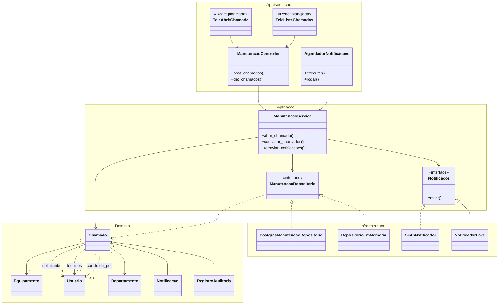

# Diagrama de classes

O protótipo implementa **UC01 (registrar chamado)**, **UC02 (consultar chamados)** e **UC09 (reenviar notificações)**. Os casos **UC03 a UC08** e as telas React fazem parte do projeto. A interface disponível no protótipo é a página `/docs` da API.

- [Apresentação e aplicação](#apresentação-e-aplicação) — entradas, casos de uso e permissões.
- [Domínio](#domínio) — entidades, relacionamentos e regras de negócio.
- [Infraestrutura](#infraestrutura) — implementações, persistência e envio de e-mail.

## Visão geral

Leia de cima para baixo. As entradas na **Apresentação** chamam o serviço na **Aplicação**, que coordena as operações do **Domínio** e usa interfaces implementadas pela **Infraestrutura**.

| Seta | Leitura |
|---|---|
| Contínua (`-->`) | Chamada entre classes ou associação entre entidades do domínio. |
| Tracejada (`..>`) | Dependência. O repositório devolve objetos do domínio. |
| Tracejada com triângulo (`<|..`) | Implementação. O triângulo aponta para a interface. |

## Apresentação e aplicação

O `ManutencaoController` recebe as requisições HTTP. O `AgendadorNotificacoes` aciona o serviço a cada 10 segundos. O `ManutencaoService` coordena os casos de uso e depende das interfaces `ManutencaoRepositorio` e `Notificador`.

Na abertura, o serviço registra o `Chamado` para o `Usuario` e cria um `RegistroAuditoria` e uma `Notificacao`.

### Casos de uso implementados

| Caso de uso | Entrada | Método do serviço | Dados e retorno | Requisito |
|---|---|---|---|---|
| UC01 · Registrar chamado | `POST /chamados` · `post_chamados()` | `abrir_chamado()` | `usuario_id`, `equipamento_id`, `descricao_problema`, `data_ocorrencia`, `informacoes_adicionais` → `Chamado` | RF01, RF08, RN01 |
| UC02 · Consultar chamados | `GET /chamados` · `get_chamados()` | `consultar_chamados()` | `usuario_id`, `filtros` (`FiltrosChamado`) → lista de `Chamado` | RF02, RF03 |
| UC09 · Reenviar notificações | `AgendadorNotificacoes.executar()` | `reenviar_notificacoes()` | Sem parâmetros | RF08, ASR03 |

### Casos de uso planejados

| Caso de uso | Método do controlador | Método do serviço | Dados e retorno | Requisito |
|---|---|---|---|---|
| UC03 · Definir prioridade | `patch_prioridade()` | `definir_prioridade()` | `usuario_id`, `chamado_id`, `prioridade` | RF04 |
| UC04 · Atribuir técnico | `post_tecnicos()` | `atribuir_tecnico()` | `usuario_id`, `chamado_id`, `tecnico_id` | RF05, RN02 |
| UC05 · Iniciar atendimento | `post_iniciar()` | `iniciar_atendimento()` | `usuario_id`, `chamado_id` | RF10 |
| UC06 · Concluir chamado | `post_concluir()` | `concluir_chamado()` | `usuario_id`, `chamado_id`, `diagnostico`, `descricao_intervencao` | RF07, RF08 |
| UC07 · Consultar histórico | `get_historico()` | `consultar_historico()` | `usuario_id`, `equipamento_id` → lista de `Chamado` | RF06 |
| UC08 · Encaminhar chamado | `post_encaminhar()` | `encaminhar_chamado()` | `usuario_id`, `chamado_id`, `departamento_id`, `justificativa` | RF09 |

### Permissões, erros e classes de apoio

- `_verificar_permissao(usuario_id, acao)` é um método privado que retorna um `Usuario`. No protótipo, exige um usuário conhecido e aceita as ações `abrir` e `consultar` (ASR02). O UC09 é acionado pelo relógio e dispensa essa verificação.
- `consultar_chamados()` restringe a consulta por papel. O solicitante vê apenas os próprios chamados. Técnicos e coordenadores veem apenas os chamados do seu departamento. A classe `FiltrosChamado` agrupa os filtros do UC02.
- `AbrirChamadoRequisicao` e `ChamadoResposta` são esquemas Pydantic de `aapresentacao/esquemas.py`. O primeiro define o corpo do POST. A função `para_resposta()` converte um `Chamado` em `ChamadoResposta`, usado no POST e no GET.

| Erro | Tratamento |
|---|---|
| `AcessoNegado` | Usuário ausente, desconhecido ou sem permissão → HTTP 403 (ASR02). |
| `EquipamentoNaoEncontrado` | `buscar_equipamento()` não encontra o equipamento na abertura → HTTP 404 (RN01). |
| `ValueError` | O domínio rejeita um dado inválido → HTTP 422. |
| `OSError` | O notificador sinaliza uma falha de envio. O serviço registra a tentativa (ASR03). |

## Domínio

O `Chamado` representa a solicitação de manutenção e concentra as regras do seu ciclo de vida. Nos relacionamentos, `*` indica zero ou mais, `1` indica exatamente um e `0..1` indica um vínculo opcional.

Cada chamado tem um solicitante, pode aguardar a atribuição de técnicos e tem no máximo um autor da conclusão. As regras de negócio verificam o papel e a autorização dos usuários. `Equipamento.departamento` e `Usuario.departamento` referenciam `Departamento`. `RegistroAuditoria.autor` referencia `Usuario`.

### Atributos

Todas as entidades têm `id`. Os atributos que representam vínculos também aparecem nas associações ou no texto acima.

| Entidade | Grupo | Atributos |
|---|---|---|
| `Chamado` | Abertura | `equipamento`, `solicitante`, `descricao_problema`, `informacoes_adicionais`, `data_ocorrencia`, `data_abertura` |
| `Chamado` | Acompanhamento | `departamento`, `estado`, `prioridade`, `tecnicos`, `data_inicio_atendimento` |
| `Chamado` | Conclusão | `diagnostico`, `descricao_intervencao`, `concluido_por`, `data_conclusao` |
| `Equipamento` | Identificação e localização | `nome`, `laboratorio`, `departamento` |
| `Usuario` | Identificação e papel | `nome`, `email`, `papel`, `departamento` |
| `Departamento` | Identificação | `nome` |
| `Notificacao` | Mensagem e envio | `chamado`, `destinatario`, `assunto`, `mensagem`, `status`, `tentativas`, `MAX_TENTATIVAS` (constante) |
| `RegistroAuditoria` | Alteração registrada | `chamado`, `autor`, `data_hora`, `campo`, `valor_anterior`, `valor_novo`, `observacao` |

As enumerações ficam dentro das próprias classes do domínio.

| Tipo | Atributo | Valores |
|---|---|---|
| `Chamado.Estado` | `estado` | `ABERTO`, `ATRIBUIDO`, `EM_ATENDIMENTO`, `CONCLUIDO` |
| `Chamado.Prioridade` | `prioridade` | `BAIXA`, `MEDIA`, `ALTA`, `CRITICA` |
| `Usuario.Papel` | `papel` | `SOLICITANTE`, `TECNICO`, `COORDENADOR` |
| `Notificacao.Status` | `status` | `PENDENTE`, `ENVIADA`, `FALHOU` |

### Operações e regras

| Operação | Situação | Regra ou responsabilidade | Requisito |
|---|---|---|---|
| `Chamado.abrir()` | Implementada | Recusa descrição vazia. Cria o chamado como `ABERTO`, registra a data de abertura e copia o departamento do equipamento. | RF01 |
| `Chamado.definir_prioridade()` | Planejada | Define ou altera a prioridade do chamado. | RF04 |
| `Chamado.atribuir_tecnico()` | Planejada | Exige um técnico e muda o estado de `ABERTO` para `ATRIBUIDO`. | RF05, RN02, RN03 |
| `Chamado.iniciar_atendimento()` | Planejada | Exige um técnico atribuído e o estado `ATRIBUIDO`. Muda o estado para `EM_ATENDIMENTO`. | RF10, RN03 |
| `Chamado.concluir()` | Planejada | Exige diagnóstico, descrição da intervenção e o estado `EM_ATENDIMENTO`. Muda o estado para `CONCLUIDO`. | RF07, RN03 |
| `Chamado.encaminhar()` | Planejada | Troca o departamento responsável. A justificativa fica em `RegistroAuditoria.observacao`. | RF09 |
| `Usuario.e_tecnico()` e `e_coordenador_de()` | Implementadas | Consultam o papel do usuário e, no segundo caso, seu departamento. São operações de apoio às verificações planejadas para UC03 a UC08. | RN02, ASR02 |
| `Notificacao.marcar_enviada()` e `registrar_falha()` | Implementadas | Atualizam o estado da notificação. Cada falha incrementa as tentativas e, ao atingir o limite, a notificação passa para `FALHOU`. | ASR03 |

## Infraestrutura

A aplicação define as interfaces em `aplicacao/interface_repositorio.py` e `aplicacao/interface_notificador.py`. O `RepositorioEmMemoria` guarda os dados no processo e pode ser usado em testes ou para rodar a API sem banco.

### Operações do repositório

| Responsabilidade | Operações de `ManutencaoRepositorio` |
|---|---|
| Chamados | `buscar_chamado()`, `listar_chamados()`, `salvar_chamado()` |
| Equipamento e histórico | `buscar_equipamento()`, `historico_equipamento()` |
| Usuários e departamentos | `buscar_usuario()`, `buscar_departamento()` |
| Auditoria | `listar_auditoria()` |
| Notificações | `listar_pendentes()`, `atualizar_notificacao()` |

### Persistência e envio de notificações

1. **Gravação (ASR01 e ASR03).** No PostgreSQL, `salvar_chamado(chamado, auditoria, notificacao)` grava o chamado, a auditoria e a notificação `PENDENTE` em uma única transação.
2. **Preparação (RF08).** Depois de obter o ID do chamado, `abrir_chamado()` usa o método privado `_preencher_confirmacao(notificacao)` para montar o assunto e a mensagem. A notificação de abertura fica reservada no PostgreSQL até a gravação do texto. Se a aplicação parar após salvar o chamado, o reenvio recompõe o texto a partir dos dados gravados.
3. **Envio (UC09).** O agendador chama `reenviar_notificacoes()`, que busca as pendências e tenta enviá-las por meio de `Notificador.enviar()`. No PostgreSQL, `listar_pendentes()` ignora reservas ativas e reserva as mensagens que devolve usando `FOR UPDATE SKIP LOCKED`. `atualizar_notificacao()` libera a reserva. Em caso de interrupção, ela vence em 5 minutos (`reservada_ate`).
4. **Resultado (ASR03).** Um envio aceito passa a `ENVIADA`. Se o envio falhar, a notificação fica `PENDENTE` até atingir `Notificacao.MAX_TENTATIVAS` (5). Depois disso, fica armazenada como `FALHOU` e sai do reenvio automático. Uma interrupção entre a aceitação pelo SMTP e a gravação do resultado pode causar um envio duplicado.
