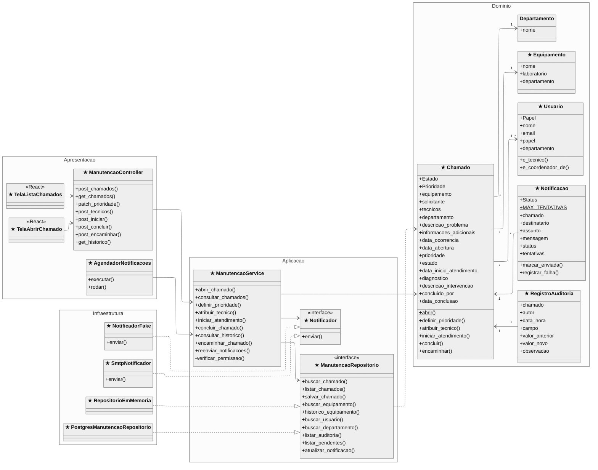

# Diagrama de classes

Classes marcadas com **★** são implementadas no protótipo (UC01 registrar chamado, UC02 consultar chamados e UC09 reenviar notificações). As outras existem só no projeto.

## Como ler

Leia **da esquerda para a direita**, seguindo as setas:

1. **Apresentação** (embaixo, à esquerda): as telas React chamam o `ManutencaoController`. O `AgendadorNotificacoes` também chama o service, mas pelo relógio.
2. **Aplicação** (meio): o `ManutencaoService` coordena os 9 casos de uso e usa as duas interfaces (`ManutencaoRepositorio` e `Notificador`).
3. **Domínio** (direita): o `Chamado` e as classes ligadas a ele. É aqui que ficam as regras.
4. **Infraestrutura** (em cima, à esquerda): implementa as duas interfaces da Aplicação. Por isso as setas dela apontam para as interfaces.

O diagrama mostra só os **nomes** de atributos e métodos, para caber numa tela. Os tipos, os parâmetros e os valores permitidos estão nas tabelas abaixo.

| Seta | Significado |
|---|---|
| Contínua (`──>`) | Usa / chama. No Domínio, é uma associação, com multiplicidade (`1`, `*`, `1..*`) |
| Tracejada (`- - ->`) | Depende de: o repositório devolve objetos `Chamado` |
| Tracejada com triângulo (`- - -▷`) | Implementa a interface |

## Notas

- **Nomes sem acento** nos grupos (`Apresentacao`, `Aplicacao`, `Dominio`): o Mermaid não aceita acento nesses nomes.
- **Três ligações aparecem só como atributo**, para o diagrama caber numa tela: `Usuario.departamento` e `Equipamento.departamento` (apontam para um `Departamento`) e `RegistroAuditoria.autor` (aponta para um `Usuario`).
- **Departamento do chamado:** na abertura, o chamado recebe o departamento do equipamento (`Equipamento.departamento`).
- **`RepositorioEmMemoria`** guarda os dados em listas. É usado nos testes e para rodar a API sem banco. Ele e o `PostgresManutencaoRepositorio` implementam a mesma interface, então trocar um pelo outro não muda o service.
- **Classes de apoio do protótipo** (fora do desenho, para ele caber numa tela):
  - `FiltrosChamado` (Aplicação) agrupa os filtros do UC02.
  - Dois erros na Aplicação: `AcessoNegado` (usuário ausente, desconhecido ou sem permissão; ASR02 → HTTP 403) e `EquipamentoNaoEncontrado` (RN01 → HTTP 404).
  - Os outros erros usam classes prontas do Python: o domínio lança `ValueError` para dado inválido (HTTP 422), e um `Notificador` lança `OSError` quando o envio falha (o service captura; ASR03).
  - Dois esquemas Pydantic no controller: `AbrirChamadoRequisicao` (corpo do POST) e `ChamadoResposta` (resposta do POST e do GET).
- **Layout ELK:** o arquivo pede o layout `elk`, que deixa o desenho compacto. Onde o ELK não existe (provavelmente no GitHub), o Mermaid usa o layout padrão: o conteúdo é o mesmo, mas o desenho fica maior.
- **`ManutencaoService` coordena os 9 casos de uso.** Ele só coordena os passos (verificar permissão, buscar, chamar o domínio, salvar, notificar). As regras ficam no Domínio.
- **`verificar_permissao()`** é um método privado do service, chamado no início de cada caso de uso (ASR02).
- **`salvar_chamado(chamado, auditoria, notificacao)`** grava as três coisas numa **única transação** do banco: ou salva tudo, ou nada (ASR01 e ASR03).
- **Envio assíncrono do e-mail (ASR03, RF08):** `abrir_chamado()` não envia nada. Ele salva a notificação como `PENDENTE`, e a lista de pendentes funciona como uma **fila salva no banco**. O `AgendadorNotificacoes` chama `reenviar_notificacoes()` a cada 10 s, que tenta enviar cada pendente. Se o servidor de e-mail cair, nada se perde: a notificação continua na fila e é tentada de novo. Depois de `Notificacao.MAX_TENTATIVAS` (5) falhas, ela vira `FALHOU`.
  - No PostgreSQL, uma notificação pode ficar **reservada** (coluna `reservada_ate`), e `listar_pendentes()` não devolve as reservadas. Uma notificação nova já nasce reservada até `abrir_chamado()` escrever o texto; assim o agendador não a envia no meio do caminho, o que geraria um e-mail repetido. `listar_pendentes()` também reserva o que devolve (`FOR UPDATE SKIP LOCKED`), então uma segunda instância da aplicação no mesmo banco não envia o mesmo e-mail. `atualizar_notificacao()` libera a reserva. Se a aplicação parar, a reserva vence em 5 minutos.
- **Uma interface por arquivo:** `aplicacao/interface_repositorio.py` (`ManutencaoRepositorio`) e `aplicacao/interface_notificador.py` (`Notificador`). As duas ficam na Aplicação porque é ela que as usa; a Infraestrutura só as implementa (inversão de dependência).
- **Fluxo de erro do protótipo:** se `buscar_equipamento()` não encontrar o equipamento, `abrir_chamado()` recusa o pedido (RN01) e o controller responde HTTP 404.

## Casos de uso: rota, método e requisito

| UC | Rota (`ManutencaoController`) | Método (`ManutencaoService`) | Recebe | Requisito | Protótipo |
|---|---|---|---|---|---|
| UC01 | `post_chamados()` | `abrir_chamado()` | usuario_id, equipamento_id, descricao_problema, data_ocorrencia, informacoes_adicionais → `Chamado` | RF01, RF08, RN01 | ★ |
| UC02 | `get_chamados()` | `consultar_chamados()` | usuario_id, filtros (`FiltrosChamado`) → lista de `Chamado` | RF02, RF03 | ★ |
| UC03 | `patch_prioridade()` | `definir_prioridade()` | usuario_id, chamado_id, prioridade | RF04 | |
| UC04 | `post_tecnicos()` | `atribuir_tecnico()` | usuario_id, chamado_id, tecnico_id | RF05, RN02 | |
| UC05 | `post_iniciar()` | `iniciar_atendimento()` | usuario_id, chamado_id | RF10 | |
| UC06 | `post_concluir()` | `concluir_chamado()` | usuario_id, chamado_id, diagnostico, descricao_intervencao | RF07, RF08 | |
| UC07 | `get_historico()` | `consultar_historico()` | usuario_id, equipamento_id → lista de `Chamado` | RF06 | |
| UC08 | `post_encaminhar()` | `encaminhar_chamado()` | usuario_id, chamado_id, departamento_id, justificativa | RF09 | |
| UC09 | — (`AgendadorNotificacoes.executar()`) | `reenviar_notificacoes()` | nada | RF08, ASR03 | ★ |
| — | — | `verificar_permissao()` | usuario_id, acao → `Usuario` | ASR02 | ★ |

## Tipos com valores fixos (enumerações)

As enumerações são tipos aninhados nas classes do domínio, sem um arquivo
`enums.py` separado. Seus nomes aparecem dentro das classes no diagrama.

| Tipo | Usado em | Valores permitidos |
|---|---|---|
| `Chamado.Estado` | `Chamado.estado` | ABERTO, ATRIBUIDO, EM_ATENDIMENTO, CONCLUIDO |
| `Chamado.Prioridade` | `Chamado.prioridade` | BAIXA, MEDIA, ALTA, CRITICA |
| `Usuario.Papel` | `Usuario.papel` | SOLICITANTE, TECNICO, COORDENADOR |
| `Notificacao.Status` | `Notificacao.status` | PENDENTE, ENVIADA, FALHOU |

## Onde ficam as regras

| Classe / método | Regra | Requisito |
|---|---|---|
| `Chamado.abrir()` | Nasce no estado `ABERTO`, com a data de abertura | RF01 |
| `Chamado.atribuir_tecnico()` | Recusa quem não é técnico; passa de `ABERTO` para `ATRIBUIDO` | RF05, RN02, RN03 |
| `Chamado.iniciar_atendimento()` | Só o técnico atribuído; só a partir de `ATRIBUIDO` | RF10, RN03 |
| `Chamado.concluir()` | Exige o diagnóstico e a descrição da intervenção; só a partir de `EM_ATENDIMENTO` | RF07, RN03 |
| `Chamado.encaminhar()` | Troca o departamento responsável | RF09 |
| `Usuario.e_tecnico()` / `e_coordenador_de()` | Informa o papel, usado em `verificar_permissao()` | RN02, ASR02 |
| `Notificacao.marcar_enviada()` / `registrar_falha()` | Atualiza o status e as tentativas; após `MAX_TENTATIVAS` falhas, `FALHOU` | ASR03 |

`Equipamento`, `Departamento` e `RegistroAuditoria` são só dados. A justificativa do encaminhamento (RF09) fica em `RegistroAuditoria.observacao`.
