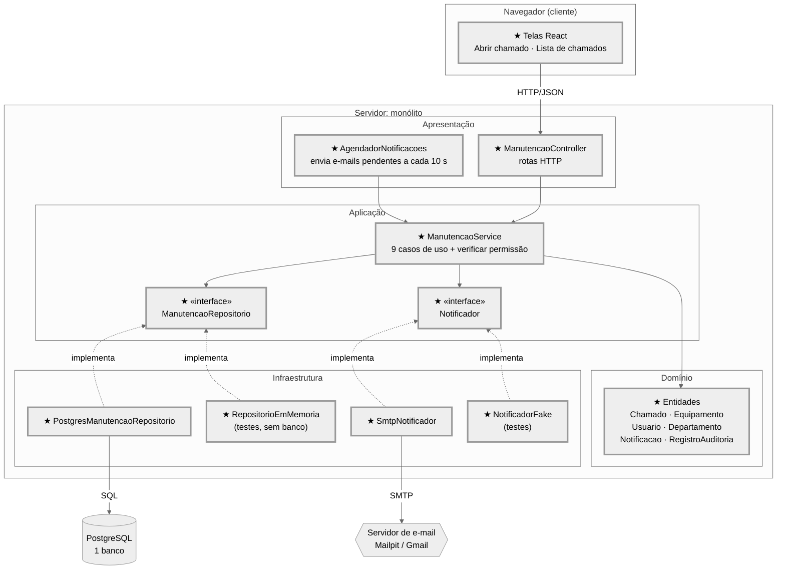

# Diagrama de componentes

Arquitetura: **cliente-servidor + monólito + camadas**, com interfaces nas bordas (estilo hexagonal).

Blocos com **borda grossa e ★** são implementados no protótipo (UC01 registrar chamado, UC02 consultar chamados e UC09 reenviar notificações). Os outros existem só no projeto.

## Como ler

Leia **de cima para baixo**:

1. O **navegador** mostra as telas React e chama o servidor por HTTP/JSON.
2. O **servidor** é um único programa Python (o monólito), dividido em quatro camadas:
   - **Apresentação** recebe o pedido (HTTP ou relógio);
   - **Aplicação** coordena os casos de uso;
   - **Domínio** guarda os dados e as regras;
   - **Infraestrutura** fala com o banco e com o e-mail.
3. As setas tracejadas **sobem** da Infraestrutura até as interfaces: a Infraestrutura **implementa** os contratos que a Aplicação define.
4. O banco e o servidor de e-mail ficam **fora** do servidor.

## Legenda

- **Seta contínua (`-->`)**: "usa / chama".
- **Seta tracejada (`-.->`) com "implementa"**: a Infraestrutura implementa a interface. Nenhuma camada de cima conhece a Infraestrutura.
- **A Infraestrutura também conhece o Domínio** (para salvar e montar os objetos). Essa seta foi omitida para o desenho ficar limpo.
- **Links invisíveis (`~~~`)** no código só posicionam os blocos. Eles não são dependências.

## O que cada camada faz

| Camada | Faz | Não faz |
|---|---|---|
| Apresentação (navegador) | Telas React: mostram dados e enviam pedidos | Regras de negócio ou segurança |
| Apresentação (servidor) | Recebe o pedido (HTTP ou relógio), chama o service, converte erros em códigos HTTP | Decidir regras |
| Aplicação | O `ManutencaoService` coordena os passos de cada caso de uso: verifica permissão, busca, chama o domínio, salva, notifica | Conhecer SQL ou SMTP |
| Domínio | Guarda dados e regras do negócio | Falar com banco, e-mail ou HTTP |
| Infraestrutura | Fala com a tecnologia (SQL, SMTP) | Regras de negócio |
