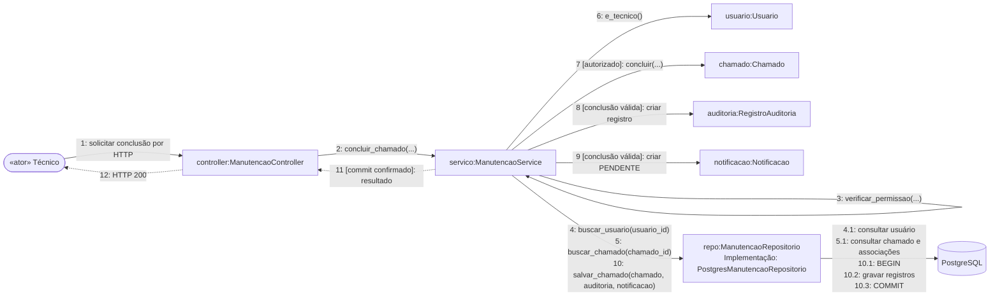
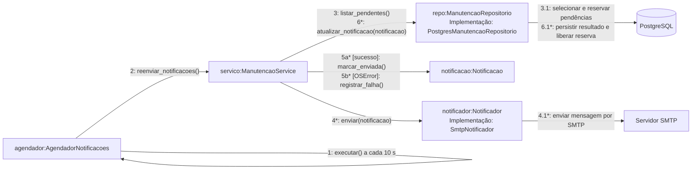

# Diagrama de comunicação

## 1. Objetivo e notação

O diagrama de comunicação representa quais objetos colaboram para executar o **UC06 — Concluir chamado**. A ordem das mensagens é indicada por números, enquanto a disposição dos participantes destaca suas conexões.

A representação utiliza Mermaid com objetos identificados por `nome:Tipo` e mensagens numeradas nas ligações. É uma representação adaptada da notação UML de comunicação: os blocos não são etapas de um fluxograma, e as setas representam mensagens entre participantes. O diagrama de sequência e este diagrama descrevem a mesma colaboração sob perspectivas diferentes.

- **Números inteiros:** ordem das mensagens principais.
- **Número decimal:** chamada realizada durante o processamento da mensagem anterior, como `4.1` dentro de `4`.
- **Condição entre colchetes:** mensagem executada somente quando a condição é satisfeita.
- **Asterisco:** repetição para cada notificação selecionada.
- **Retornos das consultas:** omitidos para reduzir cruzamentos; as consultas devolvem os objetos solicitados. As respostas finais ao controller e ao ator são mostradas explicitamente.

## 2. Concluir chamado

O fluxo representa o UC06 projetado, cujas operações estão marcadas como planejadas no diagrama de classes. O técnico informa diagnóstico e descrição da intervenção. O controller encaminha os dados ao serviço, que verifica a autorização, solicita a conclusão ao domínio e prepara os registros a serem persistidos.

As setas tracejadas 11 e 12 representam respostas. As demais representam solicitações. A posição dos objetos não determina a ordem: a leitura deve seguir os números.

### Mensagens e responsabilidades

| Mensagem | Significado |
|---|---|
| 1–2 | O técnico solicita a conclusão, e `post_concluir()` encaminha usuário, chamado, diagnóstico e intervenção a `concluir_chamado()` |
| 3–6 | O serviço inicia a verificação de permissão, recupera usuário e chamado e consulta `e_tecnico()`; também verifica departamento e presença do usuário em `chamado.tecnicos` |
| 7 | `Chamado.concluir()` valida o estado e os campos obrigatórios e registra estado concluído, diagnóstico, intervenção, autor e instante |
| 8 | O serviço constrói `RegistroAuditoria` com autor, instante, estado anterior e novo e contexto da conclusão |
| 9 | O serviço constrói `Notificacao` pendente, destinada ao solicitante e contendo a comunicação de conclusão |
| 10 | O serviço solicita a gravação conjunta do chamado, auditoria e notificação |
| 10.1–10.3 | O repositório realiza a transação; os comandos representam sua fronteira lógica, ainda que a biblioteca gerencie início e confirmação |
| 11–12 | Somente após a confirmação da transação, o resultado é devolvido ao técnico |

`verificar_permissao()` é uma operação do próprio serviço. As mensagens seguintes detalham as consultas e verificações necessárias ao caso de uso, sem impor a organização interna exata do método. Criar auditoria e notificação representa a construção dos objetos, não a introdução de um método `criar()` em suas classes.

O desenho apresenta o caminho de sucesso. As mensagens 7 a 12 dependem da autorização, e 8 a 12 dependem da conclusão válida. As respostas de sucesso não são executadas nos fluxos de erro abaixo.

### Fluxos alternativos

| Situação | Interrupção e resultado |
|---|---|
| Usuário ausente ou desconhecido | Interromper antes da conclusão; responder HTTP 403 |
| Chamado inexistente | Interromper após a busca; responder HTTP 404 |
| Técnico sem permissão, departamento incompatível ou ausência de atribuição | Não executar a mensagem 7; responder HTTP 403 |
| Estado diferente de em atendimento ou diagnóstico/intervenção inválidos | `concluir()` produz `ValueError`; não executar a persistência e responder HTTP 422 |
| Falha durante a gravação | Substituir a confirmação por `ROLLBACK`; não executar 11–12 como sucesso e responder HTTP 500 |

Uma alteração no objeto em memória não significa que ela foi persistida. Se a transação falhar, o resultado não deve ser apresentado como uma conclusão confirmada.

### Contrato e implementação

`repo:ManutencaoRepositorio` é o objeto que atende às solicitações de persistência. Ele é utilizado pelo contrato definido na aplicação e executado pela implementação PostgreSQL. A ligação do serviço com esse participante não significa que o serviço importe a classe concreta ou execute SQL.

O diagnóstico e a descrição da intervenção pertencem a `Chamado`. Não há uma entidade independente de intervenção neste modelo.

## 3. Comunicação para envio posterior

O **UC09 — Reenviar notificações** ocorre em outra execução, acionada pelo agendador. Ele não integra a requisição HTTP do técnico nem mantém aberta a transação de conclusão.

As mensagens 4, 5 e 6 se repetem para cada notificação retornada. `5a` e `5b` são alternativas: somente uma é executada em cada tentativa. A mensagem 6 ocorre após a atualização do estado do objeto, tanto no sucesso quanto na falha de envio tratada.

`registrar_falha()` mantém `PENDENTE` antes de cinco falhas e define `FALHOU` quando esse limite é atingido. Mensagens em `FALHOU` permanecem armazenadas, mas não são selecionadas para novas tentativas automáticas.

As reservas reduzem o processamento simultâneo e expiram após cinco minutos se não forem liberadas. Elas não eliminam a possibilidade de reenvio após uma falha entre a aceitação SMTP e o registro local do sucesso. Se a persistência do resultado falhar, o estado atualizado em memória não deve ser considerado confirmado no banco.

## 4. Decisões evidenciadas

| Aspecto | Onde aparece |
|---|---|
| ASR01 — Rastreabilidade | Auditoria criada junto à conclusão e salva na mesma transação |
| ASR02 — Controle de acesso | Verificações anteriores à chamada de conclusão do domínio |
| ASR03 — Confiabilidade das notificações | Persistência da pendência e processamento separado, respeitando o limite de tentativas |
| GRASP Controller e Information Expert | Serviço coordena; `Chamado` valida e executa seu comportamento |
| Inversão de dependências | Serviço usa os contratos de repositório e notificador |

O diagrama de comunicação enfatiza quais objetos precisam colaborar. A ordem detalhada, os retornos e as alternativas podem ser acompanhados no diagrama de sequência do mesmo caso de uso.
