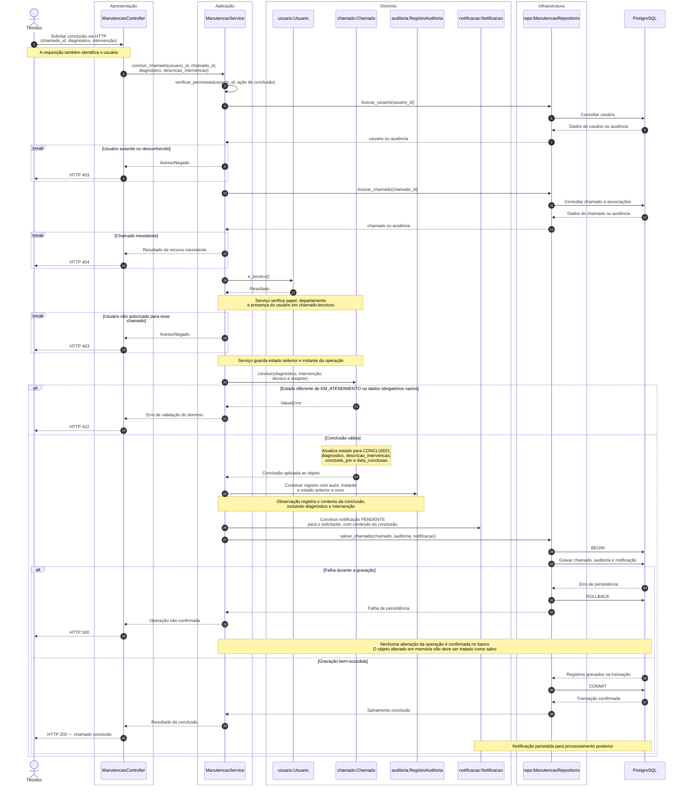
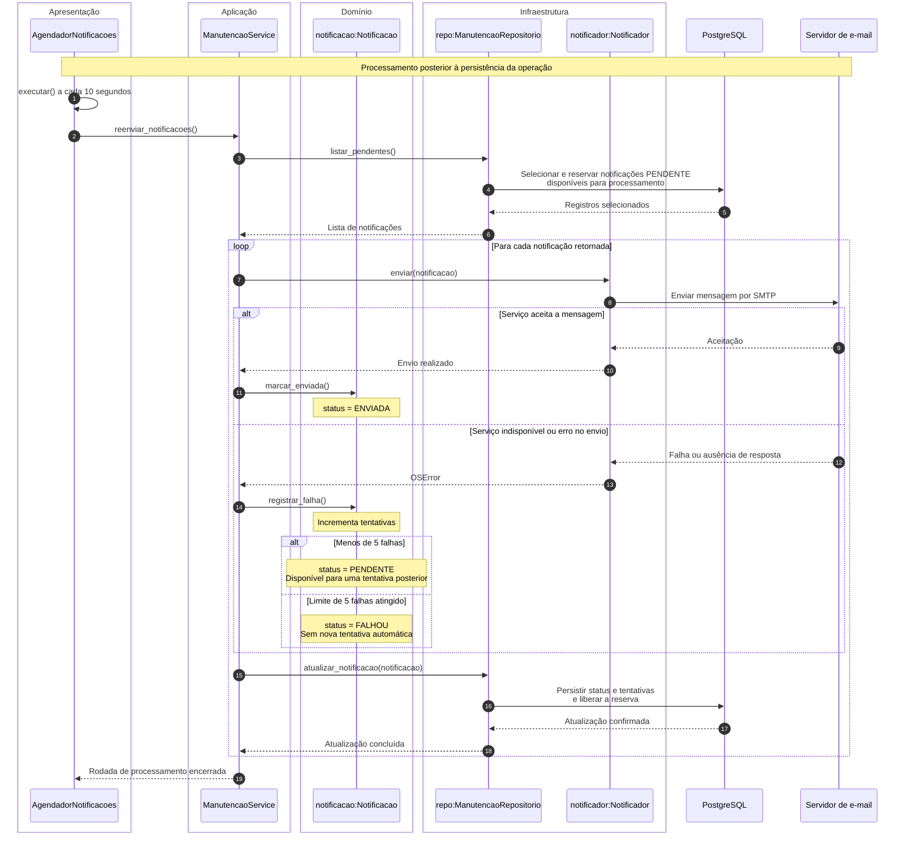

# Diagramas de sequência

## 1. Caso de uso: concluir chamado

O caso de uso **UC06 — Concluir chamado** representa a solicitação de um técnico para encerrar um atendimento, informando diagnóstico e descrição da intervenção realizada. O fluxo descreve o comportamento projetado para o RF07 e prepara a comunicação de conclusão prevista no RF08. As operações UC06 marcadas como planejadas no diagrama de classes são representadas aqui como parte do projeto do sistema.

A sequência apresenta a colaboração entre apresentação, aplicação, domínio e infraestrutura em uma aplicação monolítica. As chamadas internas são chamadas de métodos; HTTP é utilizado entre cliente e servidor, SQL na persistência e SMTP no envio externo.

A conclusão permite demonstrar os três ASRs: autorização do técnico, registro de auditoria e persistência da notificação para envio posterior.

### Participantes e responsabilidades

| Participante | Camada | Responsabilidade |
|---|---|---|
| Técnico | Ator externo | Solicitar a conclusão e fornecer diagnóstico e intervenção |
| `ManutencaoController` | Apresentação | Receber a solicitação e devolver o resultado HTTP |
| `ManutencaoService` | Aplicação | Verificar permissão, coordenar a conclusão e preparar auditoria e notificação |
| `Usuario` | Domínio | Fornecer papel e departamento para as verificações |
| `Chamado` | Domínio | Validar o estado e os dados obrigatórios e registrar a conclusão |
| `RegistroAuditoria` | Domínio | Representar autor, instante e alteração realizada |
| `Notificacao` | Domínio | Representar a comunicação pendente ao solicitante |
| `PostgresManutencaoRepositorio` | Infraestrutura | Implementar `ManutencaoRepositorio` e salvar os registros em uma transação |
| PostgreSQL | Serviço externo | Armazenar os dados e confirmar ou reverter a transação |

O ator representa a interação do técnico pela interface cliente. Não é introduzida uma classe de tela de conclusão. O participante `repo:ManutencaoRepositorio` representa um objeto `PostgresManutencaoRepositorio` utilizado pelo contrato da aplicação. Assim, a sequência mostra quem executa a persistência sem estabelecer uma dependência do serviço com a classe concreta.

Os argumentos das mensagens explicam os dados necessários à colaboração; a notação não pretende fixar todas as assinaturas dos métodos. `verificar_permissao()` é uma operação interna do serviço. A autorização da conclusão considera o papel do usuário, seu departamento e sua presença entre os técnicos do chamado.

### Sequência principal e fluxos alternativos

`BEGIN`, `COMMIT` e `ROLLBACK` explicitam a fronteira transacional da operação. Essa fronteira é executada pela infraestrutura, inclusive quando gerenciada pelo contexto de conexão da biblioteca de banco; o serviço não envia SQL diretamente.

O fluxo de chamado inexistente utiliza uma resposta 404 sem introduzir uma nova classe de exceção no modelo. A resposta 500 representa uma falha interna de persistência, sem exposição de detalhes do banco ao cliente.

O registro de auditoria identifica a mudança de estado e mantém o contexto da conclusão em `observacao`. Quando houver alteração posterior de campos, novos registros devem preservar os respectivos valores anteriores e novos. Diagnóstico e descrição da intervenção pertencem ao próprio `Chamado`; não há um participante separado chamado `Intervencao`.

## 2. Processamento posterior de notificações

O **UC09 — Reenviar notificações** é acionado pelo relógio e não pelo técnico. Ele ocorre separadamente da requisição de conclusão, podendo processar notificações tanto de abertura quanto de conclusão.

`AgendadorNotificacoes` inicia o processamento. `ManutencaoService` consulta pendências e coordena o envio. O participante `notificador:Notificador` representa uma instância de `SmtpNotificador`, utilizada pelo contrato da aplicação. A entidade `Notificacao` controla estado e tentativas.

A seleção utiliza reservas temporárias para reduzir o processamento simultâneo da mesma mensagem. Se o processamento for interrompido, a reserva expira após cinco minutos. Uma falha após o SMTP aceitar a mensagem e antes da gravação do sucesso pode causar reenvio; a reserva não garante entrega exatamente uma vez.

O estado `ENVIADA` indica que o envio foi aceito pelo serviço SMTP, não que o solicitante leu a mensagem. Se a persistência do resultado falhar, não é possível considerar o estado atualizado no banco; o tratamento do agendador deve permitir rodadas posteriores.

A política de cinco tentativas limita a recuperação automática. Uma mensagem em `FALHOU` permanece armazenada, mas não é selecionada por `listar_pendentes()`. Portanto, o fluxo não garante envio automático após indisponibilidades que esgotem esse limite.

## 3. Relação com requisitos e responsabilidades

| Etapa | Requisito ou princípio demonstrado |
|---|---|
| Verificação do papel, departamento e atribuição do técnico | ASR02 — controle de acesso |
| Validação do estado, diagnóstico e intervenção em `Chamado.concluir()` | RF07, RN03 e GRASP Information Expert |
| Coordenação da operação pelo serviço, sem SQL ou SMTP | GRASP Controller, baixo acoplamento e separação de responsabilidades |
| Persistência conjunta de chamado e auditoria | ASR01 — rastreabilidade e consistência |
| Registro da notificação junto à conclusão | RF08 e ASR03 — preservação da comunicação pendente |
| Envio posterior pelo serviço e notificador | Independência entre a conclusão e a disponibilidade do e-mail |
| Uso de `ManutencaoRepositorio` e `Notificador` | SOLID DIP e possibilidade de substituição das implementações |

Os dois diagramas se complementam: o primeiro termina com a confirmação do atendimento, enquanto o segundo trata a comunicação posterior. Essa divisão evidencia que o técnico não precisa aguardar o envio do e-mail para receber a confirmação da conclusão.
